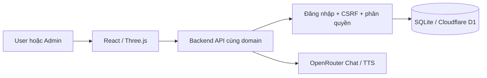

# Long Vân — web đầy đủ cho admin và user

Ứng dụng React/Vinext có backend API, database SQLite/D1, phân quyền admin/user, chat OpenRouter và voice với rồng Three.js. Code này thay thế bản frontend tĩnh trước đó.

## Chạy trên Windows

1. Cài Node.js 24 LTS nếu máy chưa có. Máy đang thực hiện dự án đã có Node tại `C:\Program Files\nodejs\node.exe`.
2. Mở `start-web.cmd`. Lần đầu script tự cài dependency, sinh `.dev.vars` và áp dụng migration database cục bộ.
3. Mở **http://127.0.0.1:8767/login**.
4. Tạo tài khoản quản trị đầu tiên bằng email, tên và mật khẩu ít nhất 12 ký tự. Không có mật khẩu mặc định.
5. Trong **Quản trị → Cấu hình AI**, nhập OpenRouter API key, chọn model rồi lưu.
6. Dùng trình duyệt khác hoặc cửa sổ riêng tư để đăng ký user và kiểm tra luồng người dùng.

Database cục bộ nằm trong `.wrangler/state`. Giữ lại thư mục đó để bảo toàn tài khoản và hội thoại. `.dev.vars` chứa `APP_SECRET`; giữ nguyên cùng database vì secret này dùng để băm mật khẩu và mã hóa API key. Các file này không được commit hoặc đưa vào bản phát hành.

## Bản Sites hiện tại

https://long-van-dragon-chat.quynhnphe182286.chatgpt.site

Bản hosted giữ đăng nhập ChatGPT và quyền riêng tư của Site. Tài khoản chủ Site được cấu hình qua `OWNER_EMAIL` làm admin gốc. Các tài khoản khác được cấp quyền user; admin có thể tạo trước tài khoản theo email hoặc sửa vai trò. Muốn người khác mở được link hosted, chủ Site còn cần cấp quyền truy cập ở Sites. Phân quyền trong ứng dụng và quyền mở Site là hai lớp khác nhau.

`AUTH_MODE=chatgpt` dùng danh tính do Sites cấp. `AUTH_MODE=password` bật email/mật khẩu, mặc định cho bản chạy trên máy. Không đưa server dùng chế độ ChatGPT ra Internet ngoài Sites gateway vì chế độ đó tin cậy các header danh tính do gateway cung cấp. Mã mô phỏng đăng nhập của starter chỉ hoạt động ở loopback trong chế độ dev và bị loại khỏi bản production.

## Luồng user

- Đăng ký/đăng nhập, đổi tên hiển thị, đổi mật khẩu ở bản email/mật khẩu, đăng xuất.
- Tạo hội thoại, gửi tin nhắn và nhận câu trả lời streaming. Hội thoại được lưu theo tài khoản.
- Nhập tiếng Việt bằng micro nếu trình duyệt hỗ trợ Web Speech Recognition; xem lại nội dung trước khi gửi.
- Nghe câu trả lời hoặc dừng giọng đọc. Audio OpenRouter điều khiển khẩu hình theo âm lượng; giọng trình duyệt dùng khẩu hình mô phỏng theo thời gian.
- Đổi tên hội thoại, lưu trữ/khôi phục, xuất JSON, xem hạn mức và 50 yêu cầu AI gần nhất.

## Luồng admin

- Tổng quan người dùng, hội thoại, số yêu cầu/lỗi trong 24 giờ và biểu đồ 7 ngày.
- Tìm, tạo người dùng; gán admin/user; khóa/mở khóa; đổi hạn mức; thu hồi phiên đăng nhập.
- Cấp link đặt mật khẩu dùng một lần, hiệu lực một giờ ở bản email/mật khẩu. **Chưa tích hợp gửi email tự động**: admin sao chép và chuyển link riêng cho người nhận.
- Cấu hình API key, model chat/TTS, mã giọng, system prompt, lời chào, độ dài câu trả lời, hạn mức cho user mới, bật/tắt đăng ký và voice.
- Tra cứu hội thoại để hỗ trợ. Mỗi lần admin xem nội dung được ghi vào nhật ký; người dùng được thông báo về quyền truy cập này trong phần thông tin của rồng.
- Xem 100 thao tác quản trị gần nhất. Không thể hạ quyền hoặc khóa admin gốc, hoặc tự khóa/hạ quyền chính mình.

## Backend và dữ liệu



- `app/ui/`: trang đăng nhập, không gian user và admin.
- `app/api/[...path]/route.ts`: cổng API Vinext.
- `server/api.mjs`: xác thực, quyền truy cập, hội thoại, gọi AI, hạn mức và quản trị.
- `server/crypto.mjs`: băm mật khẩu có salt/pepper, hash session token, mã hóa AES-GCM cho API key.
- `db/schema.ts`, `drizzle/`: schema và migration.
- `public/dragon/`: model và module Three.js. Model khoảng 18 MiB; render tối đa 30 fps khi hoạt động, nghỉ thì chỉ vẽ khi cần.
- `tests/backend.test.mjs`: kiểm tra tích hợp backend trên SQLite thật, giả lập giao thức OpenRouter.

API key chỉ được admin gửi đến backend khi cấu hình. Backend mã hóa rồi lưu; API đọc cấu hình chỉ trả trạng thái có/chưa có key. Browser user không gọi trực tiếp OpenRouter. Session email/mật khẩu dùng cookie HttpOnly, SameSite=Lax, Secure khi chạy HTTPS; token lưu dưới dạng hash. Các lệnh ghi dữ liệu kiểm tra Origin và CSRF. Mọi truy cập hội thoại đều kiểm tra chủ sở hữu ở backend.

Hạn mức tính mỗi yêu cầu chat hoặc TTS, theo ngày ở múi giờ Việt Nam. Yêu cầu gặp lỗi dịch vụ được hoàn lại lượt. Mỗi user chỉ có một yêu cầu AI chạy đồng thời. Chế độ chỉ model miễn phí được bật sẵn; không tự chuyển sang model trả phí.

## API chính

| API | Quyền |
| --- | --- |
| `GET /api/auth/status`, `POST /api/auth/setup,register,login,reset` | Luồng xác thực, tùy AUTH_MODE |
| `GET /api/me`, `POST /api/auth/logout` | Đã đăng nhập |
| `PATCH /api/profile`, `POST /api/profile/password` | Chính chủ |
| `GET/POST /api/conversations` | Hội thoại của chính chủ |
| `GET/PATCH/DELETE /api/conversations/:id` | Chính chủ; DELETE là lưu trữ |
| `POST /api/conversations/:id/messages` | Chính chủ; SSE streaming |
| `GET /api/conversations/:id/export` | Chính chủ |
| `POST /api/tts`, `GET /api/usage` | Đã đăng nhập; hạn mức cá nhân |
| `/api/admin/overview,users,config,models,conversations,audit` | Admin; kiểm tra server |

## Kiểm tra và build

```text
npm run typecheck
npm test
npm run build
```

Các kiểm tra tự động dùng SQLite thật để kiểm tra đăng nhập, session, CSRF, ngăn nâng quyền, cách ly hội thoại, cấu hình server, streaming tiếng Việt, TTS, khóa yêu cầu đồng thời, hoàn lượt khi lỗi, reset mật khẩu, khóa tài khoản và bảo vệ admin gốc. Giao thức OpenRouter được giả lập; chưa có API key thật nên chưa đánh giá giọng tiếng Việt hoặc độ trễ model thực tế. Công cụ xem trước trong ứng dụng hiện không kết nối; giao diện chưa được kiểm tra trực quan bằng trình duyệt của trợ lý. Luồng HTTP thực tế trên localhost đã được kiểm tra riêng.

## Triển khai Sites

`.openai/hosting.json` giữ nguyên project ID, khai báo `d1: DB`. Backend build thành `dist/server/index.js`; Sites áp dụng migration khi deploy. Runtime cần `APP_SECRET` (bí mật, ít nhất 32 ký tự), `AUTH_MODE`, `OWNER_EMAIL`. Có thể cấu hình `OPENROUTER_API_KEY` làm secret runtime thay cho key mã hóa trong database; khi dùng biến môi trường này, xóa key trong UI không xóa được biến môi trường.

## Tài sản và giấy phép

Mô hình gốc **Dragon Character 3D by OSCAR CREATIVO**: https://sketchfab.com/3d-models/dragon-character-3d-by-oscar-creativo-7bad9ad76293430f8e5bb24cd499c53b . Giấy phép **CC BY-NC 4.0**, dùng phi thương mại: https://creativecommons.org/licenses/by-nc/4.0/ . Bản trang đã chỉnh texture và thêm khẩu hình. File GLB gốc của bạn không bị ghi đè. Three.js 0.180.0 dùng MIT; xem `public/dragon/vendor/LICENSE.three.txt`.
